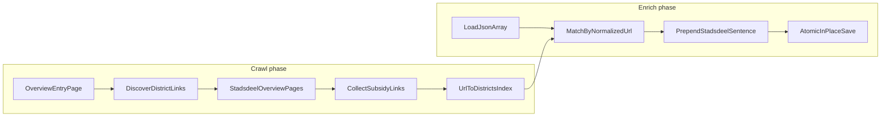

# Master plan: Amsterdam stadsdeel subsidy mapper (`sm-stadsdelen`)

## Repository state (verified)

| Fact | Source |
|------|--------|
| Workspace [`/Users/werk/Projects/sm-stadsdelen`](/Users/werk/Projects/sm-stadsdelen) is **empty** (no files, no git history in tree) | Directory listing, 2026-10-30 |
| No existing Python packaging, tests, CI, or JSON samples in-repo | Glob / grep |
| Product name aligns with repo folder `sm-stadsdelen` | User context |

**User decisions (confirmed for this master plan):**

- Input JSON: **array of objects**, each with at least `url` and `markdown`; **all other fields must be preserved** unchanged except `markdown` on matched rows.
- Output: **update input file in place**; master plan adds **optional backup** before write (recommended default-on or `--backup` flag—resolved in slice 6).
- **Tooling:** [uv](https://docs.astral.sh/uv/) for project/dependency management and running commands; [Typer](https://typer.tiangolo.com/) for the CLI (not `argparse`).
- **Git:** All commits use [Conventional Commits](https://www.conventionalcommits.org/) (e.g. `feat:`, `fix:`, `test:`, `docs:`, `chore:`); slice plans should one logical change per commit where practical.

**Assumptions (explicit):**

- Scraped `url` values refer to individual subsidy detail pages on `amsterdam.nl` (or same canonical host), not district overview URLs.
- The tool is **offline-capable for the JSON phase** if a cached district map file is supplied (optional enhancement in slice 7); default flow includes live HTTP for discovery.
- Python **3.11+** unless a future slice discovers org-wide constraints; no version pinned in-repo yet.

**Unresolved questions (must be closed in slice-specific planning or slice 2 spike):**

1. **District link discovery on the mandated entry URL** [`https://www.amsterdam.nl/subsidies/subsidies-onderwerp/`](https://www.amsterdam.nl/subsidies/subsidies-onderwerp/): Cursor WebFetch returns topic sections; plain `curl` from the dev environment returned an error page (`Er is iets mis gegaan`), with **no stadsdeel hrefs observed**. Slice 2 must capture real HTML (successful client) and confirm whether stadsdeel links live on that page, in shared navigation, or require a secondary index (e.g. [`/subsidies/centrum/`](https://www.amsterdam.nl/subsidies/centrum/) pattern). **External evidence (not verified against entry page HTML):** eight municipal districts commonly use paths `/subsidies/{centrum,noord,oost,west,zuid,zuidoost,nieuwwest}/` plus possible **Weesp**-related pages.
2. **Exact display names** for the prefix (e.g. `Nieuw-West` vs `Nieuwwest`)—derive from page `<h1>` / title where possible, with a slug→label map as fallback.
3. **Pagination** on district listing pages (e.g. “Resultaten 1 t/m 10”)—may require following “volgende” links; spike in slice 3.
4. **Full field set** beyond `url` and `markdown` in production JSON—slice 4 validates against a user-supplied sample file (not in repo yet).

---

## Problem statement

Build a Python tool that:

1. Starts at the Amsterdam subsidy **overview entry page** (configurable; default = user URL above).
2. **Discovers links to stadsdeel subsidy overview pages**, visits each, and collects **subsidy detail URLs** listed there.
3. Builds `**normalized_subsidy_url → [stadsdeel labels]**` (union across districts; stable sort order for labels).
4. Loads a user-provided JSON **array**, finds objects whose `url` matches a discovered subsidy URL, and **prepends** `Stadsdeel: x, y, z` as the **first sentence** of `markdown` (comma-separated districts).
5. Writes JSON **in place**, preserving unrelated objects and fields; repeats must be **idempotent** on `markdown`.

Non-goals for v1 (unless master plan amended): scraping subsidy body content, modifying non-`markdown` fields, publishing packages to PyPI, GUI.

---

## Target architecture



### Proposed package layout (greenfield convention)

Establish in **slice 1**; slice plans must not rename modules without updating this master plan.

```
sm-stadsdelen/
  pyproject.toml          # uv-managed; hatchling (or uv default build backend) in slice 1
  uv.lock                 # committed lockfile (slice 1)
  README.md
  src/stadsdelen/         # import name TBD: stadsdelen vs sm_stadsdelen
    __init__.py
    urls.py               # normalization + matching
    discovery.py          # entry page → district URLs
    crawl.py              # district pages → subsidy URLs
    index.py              # merge duplicates, multi-district
    json_io.py            # load/save, preserve structure
    markdown.py           # idempotent prepend
    cli.py                # Typer app + subcommands
    reporting.py          # stats, unmatched URLs
  tests/
    fixtures/html/        # recorded pages (no network in unit tests)
    fixtures/json/
    test_*.py
```

CLI sketch (names finalized in slice 6): `stadsdelen enrich path/to/subsidies.json [--entry-url URL] [--dry-run] [--backup] [--map-out cache.json]`.

### Component responsibilities

| Component | Responsibility |
|-----------|----------------|
| `urls` | Canonicalize URLs for equality: scheme, host (`www.amsterdam.nl`), path lowercasing rules, strip fragments, strip benign query params, trailing slash policy **documented and tested**. |
| `discovery` | HTTP fetch entry page; parse HTML; extract district overview hrefs; filter to expected path patterns; optional validation against minimum district count. |
| `crawl` | For each district URL: fetch page(s), parse subsidy links (same host + `/subsidies/` path heuristics), handle pagination, attach **district label** from page metadata. |
| `index` | Map normalized subsidy URL → set of labels; merge when same URL appears on multiple district pages; emit sorted list for display. |
| `json_io` | Parse JSON array; validate required keys; apply updates; **atomic replace** (write temp + rename); optional `.bak` timestamp backup. |
| `markdown` | Detect existing leading `Stadsdeel:` sentence; replace or skip duplicate; ensure single first sentence ending with `.` per user spec (`Stadsdeel: x, y, z.`). |
| `reporting` | Counts: districts found, subsidy URLs indexed, JSON rows matched/unmatched, rows skipped (already correct prefix), HTTP failures. Exit codes: 0 success with warnings optional, non-zero on fatal errors. |
| `cli` | Typer app: subcommands, options, logging level, `--dry-run` without write; use `typer.Exit` for non-zero exit codes. |

### Data artifacts

| Artifact | Format | Purpose |
|----------|--------|---------|
| `UrlToDistrictsIndex` | `dict[str, list[str]]` in memory; optional JSON cache file | Subsidy URL → stadsdeel labels |
| User JSON | `[{ "url": "...", "markdown": "...", ... }]` | Input/output |
| Crawl report | stderr or JSON log | Operational visibility |

---

## Design decisions

### URL matching and normalization

- **Single normalization function** used for both crawled links and JSON `url` values (DRY).
- Treat `http`/`https` as equivalent after normalization; prefer `https://www.amsterdam.nl`.
- **Do not** strip path segments that distinguish subsidies; **do** normalize duplicate slashes and trailing slash consistently (recommend: strip trailing slash except root).
- Document handling of **relative hrefs** (`/subsidies/foo/` → absolute).
- Matching is **exact on normalized URL**; no fuzzy title matching in v1.

### Duplicate subsidy links

- On a **single** district page: dedupe by normalized URL before adding to index.
- **Across** districts: append district label to set for that URL (multi-district subsidies).
- Same subsidy listed twice with different query strings: normalize to one key; if normalization ambiguous, prefer stricter rule and add fixture test.

### Multi-district display order

- Sort labels **alphabetically** (Dutch locale `nl_NL` if available, else UTF-8 codepoint) for stable output across runs—document in README.

### Markdown idempotency

- Define a **regex or structured parse** for first sentence: `^Stadsdeel:\s*.+?\.\s`* at start of `markdown` (multiline: only start of string).
- If present and districts **unchanged**: no-op (count as `skipped`).
- If present and districts **changed**: replace prefix sentence only; leave remainder of `markdown` intact.
- If absent: prepend `Stadsdeel: a, b, c.\n\n` or insert before existing text with appropriate spacing (slice 5 fixture tests).
- **Do not** modify objects with no index entry (city-wide subsidies not listed on stadsdeel pages remain untouched).

### JSON preservation

- Load with `json.load`; update only matched objects’ `markdown`.
- For in-place write: preserve UTF-8, `ensure_ascii=False`, indent policy **fixed** (recommend `indent=2`)—note reformatting is acceptable if documented.
- Unmatched JSON URLs: **warn**, do not fail (unless `--strict` flag added later).

### Error handling

| Failure | Behavior |
|---------|----------|
| HTTP 4xx/5xx on entry or district page | Retry with backoff (limited); collect partial index; fail crawl phase if zero districts |
| Parse errors (HTML) | Log URL + snippet; skip page or fail based on severity |
| Invalid JSON input | Exit non-zero, no write |
| Write failure | Leave original file intact (atomic temp file pattern) |
| amsterdam.nl bot/error pages | Detect via title/body heuristics; fail with actionable message (User-Agent, rate limit)—**verified risk** from local curl |

### Dependencies (proposed)

- **HTTP:** `httpx` (sync client sufficient for v1).
- **HTML:** `beautifulsoup4` + `lxml` or `html.parser` (choose in slice 2 with fixture compatibility).
- **CLI:** `typer` (with `click` as transitive dependency).
- **Tests:** `pytest`, `pytest-httpx` or `responses` for HTTP mocking; recorded HTML fixtures for parser tests.
- **Lint/format (optional slice 1):** `ruff`.
- **Project tool:** `uv` — `uv sync` for dev env, `uv run pytest`, `uv run stadsdelen` (console script defined in `pyproject.toml`).

No dependencies exist in-repo until slice 1.

### Developer workflow (uv + commits)

- Initialize with `uv init` / `uv sync` patterns in slice 1; pin Python via `.python-version` or `requires-python` in `pyproject.toml`.
- Prefer `uv add` / `uv add --dev` for dependencies; commit `**uv.lock**` with `pyproject.toml` changes.
- Document in README: clone → `uv sync` → `uv run pytest` → `uv run stadsdelen --help`.
- **Conventional Commits:** scope optional but encouraged (e.g. `feat(cli): add enrich command`); body explains why when non-obvious. Slice implementation sessions commit after each small task; types map loosely to slices (`feat`, `test`, `docs`, `ci`, `chore`).

### Automated testing strategy

| Layer | What |
|-------|------|
| Unit | `urls.normalize`, `markdown.prepend_or_update`, `index.merge` |
| Parser | Fixed HTML fixtures per district + entry page (record once from successful fetch) |
| Integration | End-to-end: fixture index + fixture JSON → expected output JSON |
| Contract | Golden file for prefix format and idempotent second run |
| CI | `uv sync --frozen` + `uv run pytest` on push (slice 8); no network in CI |

---

## Risks and mitigations

| Risk | Impact | Mitigation |
|------|--------|------------|
| Entry page lacks stadsdeel links | Empty crawl | Spike in slice 2; configurable `--district-urls` file; document fallback canonical list |
| amsterdam.nl blocks simple bots | Broken crawl | Realistic headers, retries, recorded fixtures; clear errors |
| Pagination hidden on district pages | Incomplete index | Slice 3 pagination handling + tests |
| JSON URL mismatch vs site | Low match rate | Normalization rules + report unmatched; user sample validation in slice 4 |
| In-place write corruption | Data loss | Atomic write + default backup |
| Shared subsidy pages across districts | Wrong single district | Merge labels from all district listings (by design) |
| Site structure change | Parser drift | Fixture diff alerts; versioned parser selectors |

---

## Vertical slices

Each slice gets its **own Planning Mode session** with small committable tasks. **Governance for downstream slice plans** appears at the end.

### Slice 1 — Project foundation and URL normalization

**Objective:** Runnable Python project with tested URL canonicalization—the shared foundation for crawl and JSON matching.

**Scope:** uv project (`pyproject.toml`, `uv.lock`), package skeleton, `urls` module, pytest harness, minimal README (uv-based dev install).

**Dependencies:** None.

**Outcome:** `pytest` passes for normalization cases (trailing slash, host, scheme, relative resolution helpers).

**Acceptance criteria:**

- `uv sync` succeeds from clean clone; `uv run pytest` passes.
- ≥10 unit tests covering normalization edge cases documented in master plan.
- No crawl or JSON logic yet; no Typer CLI beyond optional empty stub (full CLI in slice 6).

---

### Slice 2 — Entry-page district discovery

**Objective:** From the configured entry URL, produce a validated list of stadsdeel overview URLs and human-readable labels.

**Scope:** `discovery` module, HTTP client wrapper, HTML fixtures (recorded from production), heuristics for link selection.

**Dependencies:** Slice 1 (`urls`).

**Outcome:** Function `discover_district_pages(entry_url) -> list[DistrictPage]` with stable slug and label.

**Acceptance criteria:**

- Fixture-based tests pass without network.
- Live smoke test documented (manual or marked `@pytest.mark.network`).
- Unresolved entry-page question **closed** (document where stadsdeel links come from or add configured fallback list approved by user).

---

### Slice 3 — District page crawl and index build

**Objective:** For each district page, collect all subsidy detail links and build `UrlToDistrictsIndex` with multi-district merging.

**Scope:** `crawl`, `index`, pagination support, link filtering rules (`/subsidies/` detail pages vs navigation noise).

**Dependencies:** Slices 1–2.

**Outcome:** `build_subsidy_index(district_pages) -> dict[normalized_url, list[label]]`.

**Acceptance criteria:**

- Fixture tests for at least two districts including one paginated page if applicable.
- Duplicate URLs on one page counted once; same URL on two districts yields two labels in index.
- Crawl report structure defined (counts per district).

---

### Slice 4 — JSON load, match, and preserve

**Objective:** Read user JSON array, match objects to index by normalized `url`, without modifying `markdown` yet.

**Scope:** `json_io` load validation, matching pass, dry-run reporting of would-update rows.

**Dependencies:** Slices 1, 3.

**Outcome:** CLI subcommand or internal API `match_subsidies(json_path, index) -> MatchResult`.

**Acceptance criteria:**

- Invalid JSON / non-array / missing `url` or `markdown` fails fast with clear errors.
- Unmatched URLs listed; matched count correct on fixture JSON.
- No file write in this slice (or only `--dry-run` path).

**Note:** Obtain a **representative user JSON sample** before implementing slice 4 tasks (can live in `tests/fixtures/json/`).

---

### Slice 5 — Idempotent markdown enrichment

**Objective:** Apply `Stadsdeel: x, y, z.` prefix logic to matched objects.

**Scope:** `markdown` module; integration with match results; golden tests.

**Dependencies:** Slice 4.

**Outcome:** Pure function `update_markdown(markdown, districts) -> new_markdown` plus batch applicator.

**Acceptance criteria:**

- First run prepends correct sentence.
- Second run unchanged (idempotent).
- District set change replaces prefix only.
- Objects without index entry unchanged.

---

### Slice 6 — CLI orchestration and in-place save

**Objective:** Single command runs crawl → match → enrich → atomic in-place write with backup and dry-run.

**Scope:** Typer `cli` module (`app = typer.Typer()`), subcommands (e.g. `enrich`), `reporting`, wire modules; exit codes via `raise typer.Exit(code)`.

**Dependencies:** Slices 3, 5.

**Outcome:** Documented CLI entry point usable on real JSON file.

**Acceptance criteria:**

- `--dry-run` performs no write.
- Backup created when enabled before overwrite.
- End-to-end test with mocked HTTP + fixture JSON produces expected file on disk.
- stderr summary: districts, indexed URLs, updated/skipped/unmatched rows.

---

### Slice 7 — Optional map cache and operational hardening

**Objective:** Allow re-enriching JSON without re-crawling; improve resilience and observability.

**Scope:** `--map-in` / `--map-out` JSON cache; structured logging; optional `--strict` fail on unmatched; rate limiting between requests.

**Dependencies:** Slice 6.

**Outcome:** Two-phase workflow: `crawl --map-out` then `enrich --map-in`.

**Acceptance criteria:**

- Enrich-only run matches crawl-combined run on same data.
- Cache format version field documented.

---

### Slice 8 — CI, documentation, and live validation checklist

**Objective:** Merge-ready repo: CI, README runbook, manual validation against amsterdam.nl.

**Scope:** GitHub Actions (or equivalent) using `astral-sh/setup-uv` + `uv sync --frozen` + `uv run pytest`; README (uv install, usage, limitations), network smoke checklist.

**Dependencies:** Slice 6 (minimum); slice 7 optional.

**Outcome:** Contributors can run tests locally; Patrick can run tool against production JSON with documented expectations.

**Acceptance criteria:**

- CI runs unit/integration tests without network.
- README documents normalization, idempotency, backup, and known amsterdam.nl fetch caveats.

---

## How future slice plans must reference this master plan

1. **Single source of truth:** Every slice Planning Mode session starts by linking this document and stating which **slice ID** (1–8) is in scope. Out-of-scope items from other slices must not be implemented.
2. **No contradictions:** If a slice plan proposes a behavior change (e.g. different prefix format, output mode, or URL rules), it must include an explicit **master plan amendment** section and require user approval before implementation tasks.
3. **Traceability:** Each task in a slice plan tags affected **master plan components** (`urls`, `discovery`, `crawl`, `index`, `json_io`, `markdown`, `cli`, `reporting`) and **acceptance criteria** copied or narrowed from the slice above.
4. **Commit granularity:** Slice plans decompose into **small independently committable tasks** (e.g. “add fixture”, “implement normalize”, “wire test”); each commit uses **Conventional Commits** per this master plan. The master plan intentionally does **not** list those tasks.
5. **Verified vs assumed:** Slice spikes must update the **Unresolved questions** section outcomes in PR description or README changelog—not silently assume.
6. **Testing gate:** No slice is complete until its slice-level acceptance criteria are met; later slices must not remove tests from earlier slices without amendment.
7. **File paths:** First slice that creates a path owns the convention; renames require master plan update.

---

## Suggested execution order

Strict sequence: **1 → 2 → 3 → 4 → 5 → 6** (MVP). **7** and **8** parallelize after 6 as needed.

MVP definition: CLI enriches in-place JSON with correct multi-district prefixes, idempotent on second run, with fixture-backed tests and dry-run/backup.